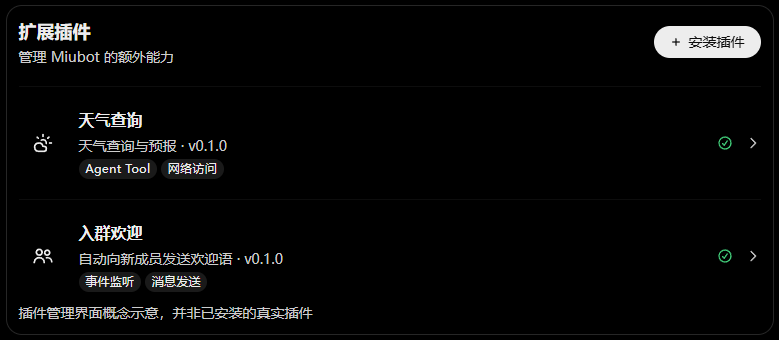
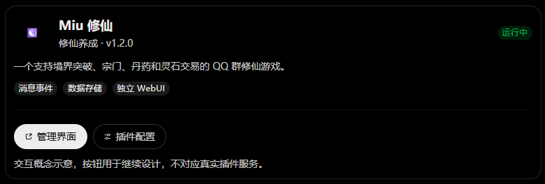

# Miubot Plugin Core：插件系统设计与开发草案

> **状态：设计草案 / 用于后续真实开发**  
> **建议入库位置：** `docs/07-高级配置/Plugin.md`  
> **依据：** 2026-10-21 查阅的 [WEP-56/MiuBot](https://github.com/WEP-56/MiuBot) 公开 `main` 分支，以及当前产品讨论；本地未推送的实现可能更新。  
> **相关文档：** [旧版扩展插件与自动化规则](07-扩展插件与自动化规则.md)、`../../AGENTS.md`、`../10-技术架构/04-Pi移植记录.md`

## 1. 关于此文档

本文档是 Miubot 插件 / 扩展模块的前期**工程设计文档**。相比旧文档 `docs/07-高级配置/07-扩展插件与自动化规则.md`，更侧重已有代码的衔接、拟新增的宿主接口、开发顺序以及测试验收。

为避免开发过程中把“构想”误当“已实现”，统一使用：

- **[现有]**：在上述公开代码中已能定位的机制或入口；并不保证所有边界已完成测试。
- **[拟定]**：推荐采用的设计，尚需编码确认；示例 TypeScript API 均属于此类。
- **[后续]**：可预留但不是首版验收目标的能力。

**核心目标：** 在尽可能保留 Pi Agent Extension 机制的基础上，增加一个**独立于 Agent Session、由 Miubot 服务进程管理的 Plugin Host**。插件可以仅监听消息、仅运行后台任务、仅注册 Agent Tool，或组合这些能力，而无需创建 Agent 会话。

**非目标（首版）：** 插件市场、任意 React 组件注入、微前端 SDK、第三方不可信代码安全沙箱、无条件热更新、插件任意修改 Agent / Provider Core。

## 2. 扩展能力

当前暂定五类扩展能力：

| 扩展能力 | 示例 | 优先级 | 说明 |
| --- | --- | --- | --- |
| Agent Tool | 生图、天气、表情包检索 | P0 | 供 Agent 在授权会话内调用，基于现有 ToolDefinition 链路接入 |
| Event Handler | 入群欢迎、消息监听、撤回处理 | P0 | 可脱离 Agent Session 工作，事件由平台层归一化后派发 |
| Config / Storage | 插件设置、独立数据存储 | P0 | 配置 Schema、持久化、密钥保护、插件数据隔离 |
| Background Task | 自动打标、定时消息、数据整理 | P1 | 统一调度、停止与取消、错误记录；优先复用已有任务雏形 |
| Web Extension | 插件配置弹窗、独立管理后台 | P1 | Miubot 宿主渲染配置表单；复杂插件自托管独立 WebUI |

它们都可以注册到一个 Plugin Host，**但不要求每个插件实现所有能力**。插件本身是生命周期和能力的组织单元；Tool / MCP / Skill 不是 Plugin 的同义词。

### 2.1 三个典型插件

- **天气查询**：只需配置 API Key，注册 `get_weather` Tool。
- **入群欢迎**：监听 `platform.group.member_joined`，从配置读取欢迎语，通过受控消息发送接口发送；完全不需要 Agent。
- **修仙文字游戏**：监听消息事件、存储玩家数据、注册定时结算任务，并可拥有独立 WebUI 维护玩家、道具、宗门和排行榜。

## 3. 与 Pi Extension 的区别

**Miubot 当前不缺 Agent Extension 加载 / 执行机制，缺的是独立 Bot Plugin 宿主。**

| 对比项 | Pi Agent Extension | Miubot Plugin |
| --- | --- | --- |
| 生命周期 | 跟随 Agent Session / 扩展运行时 | 跟随 Miubot 服务级 Plugin Host |
| 主要职责 | Agent Hooks、Tool、上下文、模型调用事件 | 平台事件、后台任务、配置与存储、Tools、可选 Agent Extension |
| 无 Agent 时工作 | 不适合承担长期平台监听 | 应当正常运行 |
| 多群、多 Session | 可以针对会话分别绑定 | 同一插件只加载一次，按事件、作用域和权限运行 |
| UI | Pi 原生 CLI/TUI 能力 | Config Schema + 可选独立 WebUI，不注入 Miubot React 树 |

例如一个「入群欢迎」插件，如果在 `getAgentSession()` 中初始化：没有会话时无法工作；多个会话可能重复订阅、重复发欢迎语；关闭会话可能意外停止插件。**不能把 Pi Extension 生命周期直接充当 Bot Plugin 生命周期。**

### 3.1 现有代码证据与接入点

以下为公开 `main` 分支中已经看到的实际实现，不是新增 API：

| 位置 | [现有] 行为 | 对 Plugin Host 的意义 |
| --- | --- | --- |
| `packages/plugin/src/extensions/loader.ts` | Pi Extension 的模块加载、Factory 初始化，包含 `jiti` 相关加载路径 | 尽量复用 Agent 扩展加载能力，**不等于**已经有独立插件安装器 |
| `packages/plugin/src/extensions/runner.ts` / `types.ts` | ExtensionRunner、ExtensionAPI、ToolDefinition 和 Agent 事件类型 | Agent 层扩展的既有契约；与新的宿主契约分开 |
| `packages/session/src/resource-loader.ts` | `DefaultResourceLoader` 支持 `extensionFactories` | 插件注册 Agent Extension 时的桥接点 |
| `packages/plugin/src/tools/index.ts` | `createBuiltinTools()` 组合 `web_search`、`load_skill`、表情包与 MCP Tools | 保留内置 Tool 机制，不必全部改造成“可安装插件” |
| `apps/server/src/agent-host.ts` | `getAgentSession()` 创建 / 复用会话，装配 `createBuiltinTools()`，通过 `extensionFactories` 注入 QQ 场景 Prompt | 后续从 Plugin Host 获取会话可用工具和扩展，而不是在 Server 添加 Tool 具体实现 |
| `apps/server/src/index.ts` | Node HTTP API、QQ 接入及固定的管理路由 | 宿主初始化、平台事件上报、插件管理 API 的装配位置 |
| `apps/web/src/App.tsx` | 已有高级配置 `extensions` 页面入口 | 未来替换占位 UI 为插件列表、配置弹窗和 WebUI 入口 |

具体参考：[extensions/loader.ts](https://github.com/WEP-56/MiuBot/blob/main/packages/plugin/src/extensions/loader.ts)、[tools/index.ts](https://github.com/WEP-56/MiuBot/blob/main/packages/plugin/src/tools/index.ts)、[agent-host.ts](https://github.com/WEP-56/MiuBot/blob/main/apps/server/src/agent-host.ts)、[resource-loader.ts](https://github.com/WEP-56/MiuBot/blob/main/packages/session/src/resource-loader.ts)。

**注意：** `apps/server` 当前直接列出有效 Tool 名称，并在已存在的 Agent Session 上调用 `setActiveToolsByName(...)`。Plugin 接入后需要替换“静态列表直接拼接”的部分，但**必须保留对象级开关和执行时权限校验**；不能只改显示列表就当完成授权。

## 4. Plugin Host 与 Session Runtime 结构

```text
apps/server                           # 组合根：启动、接入、API、装配
    │
    ├── Miubot Plugin Host           # [拟定] 服务级，一份实例
    │     ├── Plugin Registry        # 已安装/启用/状态/版本
    │     ├── Loader & Lifecycle     # 加载、启动、停止、dispose
    │     ├── Event Dispatcher       # 归一化平台事件及订阅分发
    │     ├── Tool Registry          # 插件可提供的 Agent Tools
    │     ├── Config / Storage       # 配置校验、密钥、私有数据
    │     ├── Permissions            # 宿主授权能力与对象范围
    │     ├── Task Registration      # P1：调度与取消
    │     └── WebUI Registry         # P1：独立 UI 入口
    │
    └── Session Runtime              # [现有] AgentSession
          ├── Pi Agent Extensions    # [现有] 每 Session 绑定
          └── 按当前权限从 Host 获取 Tools / Extension factories
```

### 4.1 必须守住的代码边界

- `apps/server` **是组合根**，可以注入 QQ 发送接口、配置存储、事件源；**不得实现插件 Tool、复制 Tool Schema，或把通用 Plugin Host 逻辑塞进 HTTP 路由文件**。
- `packages/plugin` 管理插件宿主、Tool 注册、生命周期、权限执行入口；不直接导入 `apps/server`。
- `packages/session` 持有 Agent Session；从 Registry 获取当前会话能力，不反向依赖 Server。
- `packages/mcp` 保留 MCP 客户端；已有 `packages/plugin/src/tools/mcp/` 负责桥接 MCP Tool。**不要为第三方插件再做一套并行的 MCP 实现**。
- `packages/context` 继续负责 Skills 的发现、内容与上下文；`plugin` 可提供 `load_skill` Tool 入口，不能把整个 Skill 内容系统搬进 Plugin Host。
- `session ↔ plugin` 当前存在类型引用，新增接口尽量使用最小契约而非暴露 `AgentSession` 整体，避免继续扩大双向耦合。

### 4.2 建议的增量目录（[拟定]，并非现有目录）

```text
packages/plugin/src/
  extensions/        # 现有 Pi Extension，优先保留
  tools/             # 现有内置 Tool，优先保留
  host/
    manifest.ts      # 插件元信息校验
    registry.ts      # 实例与能力目录
    loader.ts        # 插件入口发现/加载
    lifecycle.ts     # setup/stop/dispose
    events.ts        # 事件分发
    context.ts       # 最小能力接口
    permissions.ts   # 执行时授权接口
    config.ts        # Schema 校验/配置读写契约
    webui.ts         # 独立 WebUI 入口注册（P1）

apps/server/src/
  ...                # 保持 QQ 与 API 装配，适度拆分管理路由
```

不要为了目录整齐提前拆十几个 Package，也不要在首版引入独立插件进程、复杂容器编排。

## 5. 插件声明与开发者接口（[拟定]）

首版采用 **manifest + TypeScript/JavaScript entry**。Manifest 描述身份与能力；入口实现逻辑。**示例是设计目标，不是仓库已存在的 `definePlugin` API。**

### 5.1 Manifest 建议

```json
{
  "id": "example.welcome",
  "name": "入群欢迎",
  "version": "0.1.0",
  "apiVersion": "1",
  "entry": "dist/index.js",
  "description": "新成员入群时发送欢迎消息",
  "capabilities": ["event.handler", "config"],
  "permissions": ["platform.group.member.read", "platform.message.send"]
}
```

约束：`id` 全局唯一且稳定；`apiVersion` 与插件版本分开；`entry` 只能指向已安装插件目录内的实际文件；对 Manifest 进行完整校验，拒绝路径穿越和重复 ID。权限声明用于提示和宿主能力授予，**不是进程级沙箱**。

初期可将 Manifest 定义在单一位置，待安装器稳定后再确定磁盘规范（`miubot.plugin.json` 或 `package.json#miubot`），不要同时支持多个不必要的格式。

### 5.2 插件入口示例

```ts
// 伪 API：说明期望的开发体验，尚不能在当前仓库直接运行。
import { definePlugin } from "@miubot/plugin";

export default definePlugin({
  id: "example.welcome",
  async setup(ctx) {
    ctx.events.on("platform.group.member_joined", async (event) => {
      if (!(await ctx.permissions.canSend(event.botId, event.groupId))) return;
      const { welcomeText } = await ctx.config.get();
      await ctx.messages.send({
        botId: event.botId,
        target: { type: "group", id: event.groupId },
        text: welcomeText,
      });
    });
  },
});
```

建议对外暴露最小 `PluginContext`：`logger`、`events`、`config`、`storage`、`tools`、`messages`、`onDispose`，P1 才加入 `tasks` 与 `webui`。没有相应授权时，相关能力不可用或执行报错；**不要直接传入 Node `Server`、完整 Runtime、`AgentSession`、QQ SDK 或管理员凭据**。

Host 在 `setup()` 阶段登记 Tool / Handler，注册必须支持撤销；将返回的清理函数、事件订阅、定时器等纳入统一 Dispose 栈。Plugin 的一次加载不能因为多个 QQ 会话而重复执行。

## 6. 事件系统（P0）

### 6.1 事件来源和粒度

首版仅接入**实际存在且能稳定提供的 QQ 官方事件**，再逐渐完善 OneBot / NapCat。建议分类：

- `message.received`：标准化的入站消息；可以用于统计、关键词功能和游戏指令处理。
- `platform.group.member_joined`：平台支持时才派发；不能假设所有 QQ 机器人协议都有对应事件。
- `message.sent`：发送成功后的观察事件；不等同于入站事件。
- `platform.raw`：可选高级事件；默认只允许可信插件订阅，并明确协议字段不稳定。

标准化事件至少包含：`eventId`、`type`、`platform`、`botId`、`timestamp`、`scope`（如 group/c2c）、`peerId`、`senderId?`、`payload`。原始平台字段保持在隔离的 `raw` 中，开发者应优先消费标准字段。

**事件语义要先明确**：何时触发（消息过滤前 / 后）、是否允许消费或修改、异常是否阻断主消息流水线。推荐 P0 先实现**只读观察事件与独立动作**；不要让任意插件都能隐式修改 QQ 消息和 Agent Prompt。

### 6.2 分发与错误隔离

- 一个插件抛异常，记录带 `pluginId/eventId` 的错误；默认**不得阻断其他插件或正常 QQ 消息流程**。
- 明确每个 Handler 的超时、并发上限、积压队列及丢弃策略，防止繁忙群聊或慢插件拖垮主消息循环。
- 一个事件可能重复到达；游戏奖励、支付、签到等写操作需按 `eventId` 幂等处理。
- 不将 Event Handler 等同于模型 Tool 执行。它可以不用 LLM；若调用 LLM，也应通过宿主服务接口并接受成本与权限限制。

## 7. Agent Tool 桥接（P0）

**保留现有：** `createBuiltinTools()`，`DefaultResourceLoader`，Pi `ToolDefinition` / `ExtensionRunner`。新增 Registry 只负责补足插件 Tool 的发现、命名冲突检查、启停与会话授权。

建议装配链：

```text
插件 setup() -> 注册 ToolDefinition
               -> Host Registry（记录 pluginId / toolName）
               -> Session 创建或刷新能力集
               -> Tool 调用前再次核对插件状态、会话权限和参数
               -> 执行 Tool（超时/取消/审计）
```

**P0 约束：**

1. `pluginId + toolName` 唯一，禁止无提示覆盖内置 Tool 或其他插件；对 LLM 暴露的最终 Tool 名称要稳定、可预测。
2. 授权分为：插件已启用、宿主授予能力、Bot / 群 / 用户允许、当前 Tool 允许。**插件已加载 ≠ 任意群友均可调用。**
3. 权限不仅影响 `setActiveToolsByName()`，还必须在**统一执行入口**校验，防止已有会话或间接调用绕过。
4. 插件停用后立即拒绝新 Tool 调用，撤销 Registry 注册；既有 Session 可按现有 `rebuildAgentSessions()` 或增量更新策略重新同步，先保证正确性。
5. 对停用时正在运行的 Tool 定义取消 / 等待策略；优先取消可取消任务、有限时间等待清理，不能假设撤销注册会终止已执行的请求。
6. **Tool 的入口属于 `plugin`，底层业务服务按领域归属。** 例如表情包文件存储、图片任务服务，不因 Tool 调用而必须搬进 Plugin Host。

## 8. Config UI 与 Plugin Storage（P0）

### 8.1 两类数据分开

- **Config**：用户预期在 Miubot 工作台编辑的少量设置（欢迎语、API 地址、开关、Host、端口、管理员认证配置等）。
- **Storage**：插件自己持久化的业务数据（玩家、装备、排行榜、统计等）。这不是通用填表弹窗的职责。

配置管理由宿主负责 Schema 校验、默认值、读取与更新；存储应以插件 ID 隔离命名空间，避免插件任意覆盖 Miubot 全局配置。

### 8.2 Schema 自动渲染

尽量基于常见 JSON Schema 子集描述字段：`object`、`string`、`number/integer`、`boolean`、`enum`、`required`、`default`、`minimum/maximum`、`description`，再通过少量 UI 元数据定义 `password`、`textarea`、分组与排序。

示例（**拟定声明格式**）：

```json
{
  "type": "object",
  "properties": {
    "welcomeText": {
      "type": "string",
      "title": "欢迎语",
      "default": "欢迎来到本群！",
      "maxLength": 500,
      "x-ui": { "widget": "textarea", "group": "消息设置" }
    },
    "webHost": {
      "type": "string",
      "title": "管理后台监听地址",
      "default": "127.0.0.1",
      "x-ui": { "group": "管理后台" }
    },
    "webPort": {
      "type": "integer",
      "title": "管理后台端口（0 为自动）",
      "default": 0,
      "minimum": 0,
      "maximum": 65535,
      "x-ui": { "group": "管理后台" }
    },
    "adminPassword": {
      "type": "string",
      "title": "管理员密码",
      "writeOnly": true,
      "x-ui": { "widget": "password", "group": "管理后台" }
    }
  },
  "required": ["welcomeText"]
}
```

`Host / 端口 / 管理员密码` **不是每个插件的固定必填项**，只在插件提供独立后台且确有需要时出现。管理员密码配置建议采用“设置新密码 / 保持原值”语义，不向浏览器回传密码；插件认证应存密码哈希，不存明文。API Token / 外部密钥应作为 secret 单独处理，至少做到不回显、不进日志、不出现在公开配置响应中。

配置弹窗建议体验：**编辑本地草稿 → 校验 → 保存 → 显示成功 / 重启提示**。Schema 可支持插件声明 `requiresRestart`，或由宿主判断配置是否支持动态更新；不要每次改一条欢迎语就无条件重启整个 Miubot。

### 8.3 存储边界

首版可以复用当前 `apps/server/.miubot/` 的本地数据目录，但插件数据应划分专有子目录或命名空间。**不要把具体持久化格式写死进公共 Plugin API**：未来迁移 SQLite 时，插件接口不应该集体破坏。

备份和卸载需区分“卸载代码”和“删除插件数据”；删除业务数据必须二次确认。存储 API 若只支持 KV，应允许复杂游戏插件自行维护数据库，而非强迫所有复杂数据套 KV。

## 9. 插件自身 WebUI（P1）

**原则：插件不能注入或改变 Miubot 自身的 React WebUI。** 宿主只提供管理入口和自动表单，不承诺微前端兼容。



| 方式 | 由谁开发 / 渲染 | 适用场景 |
| --- | --- | --- |
| **Config UI** | 插件声明 Schema，Miubot 自动渲染弹窗 | 欢迎语、Host、端口、账号/认证设置、开关 |
| **Standalone WebUI** | 插件作者自行实现并托管，Miubot 只显示“打开管理界面”入口 | 修仙游戏玩家数据、装备、宗门、排行榜、复杂图表 |



### 9.1 独立 WebUI 推荐协议

初期使用**独立地址 + 新标签页**，不在 Miubot 站点同源路径下注入第三方 HTML/JS。

插件通过 Host 注册当前管理入口（**拟定**）：

```ts
// 伪 API；插件启动自有 HTTP 服务，Host 仅登记入口
const server = await startGameDashboard({ host: "127.0.0.1", port: 0 });
ctx.webui.register({ title: "修仙管理后台", url: server.url });
ctx.onDispose(() => server.close());
```

必要约束：

- 插件可以使用 React / Vue / Svelte / 原生 HTML，Miubot 不加载其 JS 到自己的页面。
- 插件服务默认只监听 `127.0.0.1`；暴露到 LAN / 公网时必须明确启用认证、HTTPS 与访问控制，不将明文默认密码对外开放。
- 浏览器中的 `localhost` 指**浏览器所在机器**，远程管理或容器部署时不能直接把容器内 `127.0.0.1` URL 当成可访问地址；应明确显示“仅本机访问”或配置外部访问入口。
- 插件独立地址具有独立 Origin；不要共享 Miubot 管理站点 Cookie、LocalStorage、管理员令牌，也不要对第三方页面无条件开启宽松 CORS。
- Miubot 对登记的 URL 校验协议、来源及更新权限，不在后台替插件任意代理请求；防止开放式跳转和管理端误访问风险地址。
- 插件后台认证由插件自身负责。若以后做 Miubot 单点登录，只传**有期限、有限权限**的凭证，不传管理员密码。
- 停用插件时注销入口；打开按钮只在服务健康且地址适合当前访问环境时显示。

### 9.2 Web 工作台展示

高级配置 → **扩展插件**：

- 列表项：图标、名称、版本、作者、说明、状态、能力标签、已授予权限、最近错误。
- 操作：`配置`（存在 Schema 才显示）、`管理界面`（存在可访问 WebUI 才显示）、`启用/停用`、`查看日志`。
- 详情：插件来源、当前版本、能力说明、运行范围、配置表单、状态与错误。
- **首版不做插件市场，也不做任意前端组件注入。**

## 10. Background Task（P1）

图片打标已有调度雏形时优先复用，而不是另起一套任务系统。Plugin Host 只注册任务定义与调度关系，底层执行仍由通用任务运行时负责。

必须考虑：插件停用取消任务、重启恢复策略、是否允许错过后补跑、同任务并发互斥、超时与重试、幂等键、失败日志。定时消息等具有外部副作用的任务默认不应无限自动重试。

Agent 主动发言是 Agent 行为策略，插件定时任务是通用调度机制；两者可以调用同一 Scheduler，但概念上不要混为一谈。

## 11. 插件生命周期与失败策略（P0）

```text
发现 -> 校验 -> 安装(初期本地可信源) -> 已禁用
                                      │
                                      ▼
                                    启动中
                                  /      \
                              运行中      启动失败
                                │            │
                              停止中 <---------
                                │
                              已禁用 -> 卸载代码（数据保留或显式删除）
```

- **启动顺序：** 校验 manifest / API 版本 → 读取配置 → 授权宿主能力 → 加载模块 → setup → 注册资源 → 标记运行中；依赖缺失或 setup 失败需回滚已注册资源。
- **关闭顺序：** 立即禁止新事件与新 Tool 请求 → 处理在途任务 → 撤销订阅 / 注册项 → 调用 dispose → 标记禁用。
- **错误隔离：** 单个插件失败不能拖垮整个 Bot；错误信息应记录插件 ID、事件 / Tool ID、时间与调用来源，并对管理 UI 进行敏感信息脱敏。
- **恢复：** 服务重启按用户启用状态重新启动插件；反复启动失败应进入错误态并提示，而非无限重启循环。
- **热重载：** 非 P0 验收目标。先保证“停用后资源真的清理干净”，再考虑无重启更新。

### 11.1 插件来源与可信度

首版仅支持管理员明确安装的**本地可信插件**，可在后续扩展 Git 仓库或包安装。插件代码运行在当前 Node 进程中时，即使 API 只暴露少量能力，仍可能访问进程文件、环境变量和网络；Manifest 权限声明只是**宿主管理契约**，不是操作系统级隔离。

如果未来要支持不可信社区插件，必须另行评估独立进程 / 容器、受控 IPC、资源配额等安全隔离设计，不能把“接口上没有给”当成真正的权限隔离。

## 12. 权限与作用域（P0）

推荐至少区分：

1. **安装授权**：插件声明需要哪些宿主能力，管理员可见并确认。
2. **实例开关**：插件是否在服务级启用（一个 Host 单例）。
3. **对象范围**：允许作用于哪些 Bot / 群 / 私聊对象；Event Handler 和 Tools 均须遵守。
4. **Tool 权限**：在模型获取工具与实际执行时均检查会话 / 用户授权。
5. **敏感能力**：主动发消息、读写数据、外部网络请求须经过相应宿主策略；后台插件尤其不能仅凭入站事件绕过群权限。

避免新造与现有 `apps/server/src/agent-host.ts` 里 `enabledToolNames()`、对象配置并行的权限来源。先把这些决策抽成统一可调用的策略接口，再让 Plugin Host / Session 共享。

## 13. 管理 API（[拟定]，尚非现有端点）

只建议先定义语义，路径可在编码时与现有 Node HTTP 路由风格统一：

| 操作 | 建议 API | 主要返回/影响 |
| --- | --- | --- |
| 列出插件 | `GET /api/plugins` | 已安装插件摘要、版本、状态、能力，不返回密钥 |
| 读取详情 | `GET /api/plugins/:id` | 描述、Schema、运行状态、错误、UI 可用性 |
| 保存配置 | `PUT /api/plugins/:id/config` | 服务端按 Schema 验证；secret 遮蔽 |
| 启用/停用 | `POST /api/plugins/:id/enable` / `disable` | 状态迁移及失败结果，幂等处理 |
| 获取管理入口 | `GET /api/plugins/:id/webui` | 经过权限确认的可访问链接或不可用原因 |
| 安装本地插件 | `POST /api/plugins/install` | 校验包、声明能力、安装结果；首版仅可信来源 |

**注意：** 目前公开仓库 `apps/server/src/index.ts` 的管理 API 使用固定路由。新增 Plugin API 应通过轻量路由模块装配，而不是继续无限扩展一个超级 `index.ts`；但也不必为了插件引入完整新 Web 框架。

**管理面安全前置条件：** 公开源码目前可见通用 `OPTIONS` 响应设置 `Access-Control-Allow-Origin: *`，而服务通常监听本机地址。后续一旦允许远程访问、插件安装、修改插件密钥和管理员凭据，就必须重新梳理**管理 API 的身份认证、浏览器 Origin / CORS、CSRF、监听地址与远程暴露策略**。不能因为初期绑定 loopback 就假定管理接口天然安全，也不能把插件自身管理员密码复用为 Miubot 管理凭据。

## 14. 实际开发顺序

### 阶段 A：最小服务级 Plugin Host（P0）

- [ ] 确定 Manifest 格式、API 版本与 Schema 校验。
- [ ] 创建服务级 `PluginHost`：发现、本地加载、启动、停止、dispose、状态与日志。
- [ ] 提供最小 Event Dispatcher（从已有 QQ 消息流注入标准化事件）。
- [ ] 实现 Config 读写 / 校验与独立 Storage 命名空间。
- [ ] 编写一个**纯事件插件**（入群欢迎或关键词回复），证明无 Agent Session 也能工作。

### 阶段 B：接入现有 Agent 能力（P0）

- [ ] 让插件注册的 ToolDefinition 与现有 `createBuiltinTools()` 合并为当前会话可用工具。
- [ ] Tool 重名检测、作用域过滤与调用前二次权限检查。
- [ ] 启停同步现有 Session 的有效 Tool 集合，并解决在途调用问题。
- [ ] 可选的 Pi Extension factories 桥接至 `DefaultResourceLoader`。
- [ ] 内置 Tools **不强制迁移成插件包**，先验证新旧工具共存。

### 阶段 C：工作台管理闭环（P0→P1）

- [ ] 插件列表、状态、启停、错误与版本展示。
- [ ] Schema Config 表单生成、校验、secret 遮蔽、重启提示。
- [ ] 独立 WebUI 入口登记、停止时撤销与远程地址提示。
- [ ] 本地可信包安装 / 卸载（保留与删除数据区分）。

### 阶段 D：后续扩展（P1+）

- [ ] 统一后台任务与调度；复用现有图片打标任务机制。
- [ ] 精细权限管理、能力审计、单插件用量统计。
- [ ] 稳定的插件 SDK / 模板及兼容性测试。
- [ ] 根据真实需求再评估隔离进程、升级与热重载；不预先建设市场。

## 15. 最小验收用例

1. **不依赖 Agent：** 服务启动且没有聊天 Session 时，入群欢迎插件收到受支持平台事件并执行一次。
2. **不重复触发：** 创建 10 个 Agent Session，同一平台事件的插件监听仍只注册一次。
3. **Tool 共存：** 插件 Tool 与原有 `web_search` / `load_skill` / MCP Tool 共存，不改变内置注册来源。
4. **权限拒绝：** 禁用某群生图 Tool 后，既不能在模型工具集看到，也不能通过既有 Session 的直接执行路径绕过权限。
5. **干净停用：** 停用插件后不再响应新事件、Tool 调用拒绝、WebUI 入口消失、调度器资源关闭；再启用不出现重复监听。
6. **配置正确：** 无效端口、超长欢迎语被拒绝；secret 不从 GET API / 日志回显；保存配置后行为与重启提示一致。
7. **业务数据隔离：** 修仙插件可以维护自己的玩家数据，停用 / 卸载代码不会默认清除数据。
8. **异常隔离：** 插件 setup、事件处理或 Tool 执行异常时，记录错误且正常 QQ 消息处理继续运行。
9. **WebUI 隔离：** 独立页面不会获得 Miubot 管理后台的 Cookie / Token；远程部署不会错误打开访问者自己电脑的 localhost。
10. **工程边界：** Plugin Host 不导入 `apps/server`，新增 Tool 实现不进入 Server，`npm run check` 和相关单测通过。

## 16. 待决策事项

以下不要在第一轮 Coding 时自行拍板成永久公共协议：

| 问题 | 当前倾向 |
| --- | --- |
| Manifest 放在哪里 | 选一个明确位置，优先简单；不同时支持多种格式 |
| 插件代码来源 | 首版管理员安装的本地可信包 |
| Tool 名称冲突 | 拒绝重复注册，错误可见；确定命名空间规范后再兼容 |
| 自定义插件配置存储 | Host 校验并保存；Secret 使用专门的掩码与写入语义 |
| Plugin Storage 引擎 | 先提供稳定命名空间接口，复杂插件可维护自己的 DB |
| 任务调度归属 | 复用已有任务机制，不在 Plugin 内重复实现 Scheduler |
| Pi Extension 兼容范围 | 尽可能复用非 TUI 扩展，不承诺依赖 Coding CLI / Bash 的扩展开箱可用 |
| 插件停用后的在途 Tool | 倾向禁止新执行、取消可取消任务并有限等待，实施前明确超时 |
| 插件 WebUI 访问方式 | 首版独立端口和新标签页；远程部署需明确外部入口 |
| UI Schema 标准 | 采用 JSON Schema 子集及少量 UI Hint；避免支持任意渲染代码 |

## 17. 开发前检查清单

接手真实实现任务时：

1. 先运行 `git status --short`，确认本地工作区已有变更，不覆盖他人的工作。
2. 阅读根目录 `AGENTS.md` 与对应模块代码，核对本地新功能与本文档的差异。
3. 确定当前需求属于服务级 Plugin、Agent Extension、Tool、MCP、Context 还是 Server 平台适配，不因“哪里调用”就把实现放在哪里。
4. 先写最小接口契约与测试，再接入 QQ 消息流、Session Tool 装配，最后做工作台。
5. 按项目约定运行 `npm run check`、相关 `npm test`；**未经用户要求不运行 `npm run build`，不主动提交 Git**。
6. 更新本文件中 [现有] / [拟定] 的状态与实际路径，避免后续 Coding Agent 模仿已过时的架构设想。

---

**一句话原则：** `Miubot Plugin` 是服务级的扩展单元，`Pi Extension` 是其中一种可注册的 Agent 能力；Miubot 提供稳定机制和边界，插件决定自己要做什么。
