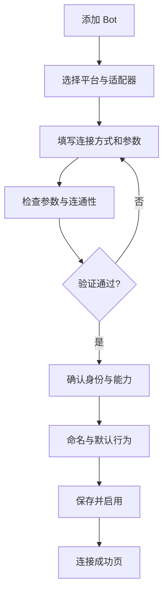

# 添加平台向导 · 交互详细设计

**入口**：平台列表顶部「添加 Bot」、首页首次配置引导。  
**形态**：独立页面式步骤向导（首次接入友好）；编辑已存在实例复用部分组件，但不改变原实例身份。

## 总体流程

步骤条：`1 选择平台 → 2 连接配置 → 3 验证连接 → 4 完成`。步骤三和四的实际名称可因适配器能力略有变化。保留草稿，用户返回上一页不丢字段。

## Step 1 · 选择平台和接入方式

- 首屏展示“QQ 官方机器人”“QQ · OneBot v11（如 NapCat）”卡片。
- 点击卡片进入配置；卡片显示支持方式、能力警告、说明链接。
- 对于 OneBot：选择 `WebSocket 连接到已有服务` 或 `等待服务连接（反向 WS）`（仅在当前适配器实际实现时提供）。
- 对于扫码：仅在具体接入端明确支持扫码时展示，**不能默认认为 QQ 官方应用密钥支持扫码登录**。
- 可预留“其他平台”区域，但不可把未实现平台标为可用。

## Step 2 · 连接配置（按适配器动态表单）

**QQ 官方 API 示例字段**（以目标官方产品当时文档为准）：

| 字段 | 控件 | 规则 |
|---|---|---|
| Bot 显示名称 | 文本 | 可选，默认优先用已验证资料 |
| AppID | 文本 | 必填、去空白、标明用途 |
| App Secret / Token | 密码 | 必填、不回显，保管在服务端 |
| 网络参数 | 高级折叠 | 仅暴露后端支持的参数 |

**OneBot WS 示例字段**：

| 字段 | 控件 | 规则 |
|---|---|---|
| WS 地址 | URL 输入 | `ws://` / `wss://`，可校验协议与格式 |
| Access Token | 密码 | 按服务端要求；支持可空但不默认安全 |
| 连接超时 | 数值 | 高级项，设合理边界 |
| 反向 WS 监听地址 | 文本/地址 | 只在反向模式出现，外网监听需明显风险提示 |

**扫码模式（若适配器实现）**：先由宿主请求一次性二维码与状态；显示有效期/刷新、已扫码待确认、成功/过期/取消；不在前端存储可复用凭证。

## Step 3 · 验证连接（分阶段，不混淆）

| 阶段 | 检查项 | 示例反馈 |
|---|---|---|
| ① 参数 | 必填字段、URL、协议支持 | `WS 地址格式不正确` |
| ② 网络 | DNS / TCP / TLS / WS 建立 | `网络可达，但 WebSocket 握手失败` |
| ③ 认证 | 认证成功/失败 | `认证失败：检查 Token` |
| ④ 协议 | 可收到预期事件/获取 Bot 身份 | `连接已建立，未收到有效 OneBot 事件` |
| ⑤ 能力（可选） | 可用事件类型、消息发送等 | `文本发送未验证：可在完成后发送测试消息` |

测试状态可显示运行中、通过、失败、跳过/不支持；发生错误时保留输入并定位到可能字段。高级详情允许复制 **已脱敏** 诊断信息。

**不要把“连接成功”写成“消息收发一定正常”**。真实发消息测试独立进行，且必须指定目标和确认。

## Step 4 · 确认并完成

显示经验证的 Bot ID、昵称、头像（有则显示）、适配器名称、能力矩阵概况。用户设置：

- 本地显示名称（允许覆盖）。
- 保存后立即启用连接（默认开启），或仅保存草稿。
- 默认人格、默认模型策略：引用全局配置，首次接入时可选择；高级覆盖折叠。
- 可处理会话范围：默认需明确的授权/允许策略，避免意外进入所有群自动插话。

完成页：`已保存 / 已建立连接 / 发送能力是否验证` 分开显示；提供「查看 Bot」「前往会话」「测试消息（明确目标）」三个后续动作。

## 核心错误及恢复

| 错误 | 行为 |
|---|---|
| 密钥错误 | 停留第二/三步，强调认证字段，保护输入 |
| WS 服务未启动 | 允许重试，不抹除配置 |
| TLS 证书异常 | 提示证书问题，不默认允许忽略验证 |
| Token 缺失 | 根据适配器是否允许匿名给出明确解释 |
| 重复账号/应用 | 标注已有实例名称，建议打开或新建另一个连接（若平台允许） |
| 连接后身份变化 | 阻止静默绑定到旧会话，要求确认映射 |
| 平台权限不足 | 连接保留但标降级，并列出缺失能力 |
| 连接中离开页面 | 给出保存草稿/取消选项，后台连接不自动越权继续 |

## UI 文案示例

- `先选择 Miubot 如何连接到你的 QQ 机器人。不同接入方式支持的功能可能不同。`
- `已通过认证，正在等待消息事件…`
- `连接成功。发送消息能力尚未测试。`
- `为了避免打扰真实群聊，发送测试消息前需要选定目标并确认。`

## 验收用例

1. 官方模式参数正确/错误各走通一次；失败能重新编辑与重试。
2. OneBot WS 服务未启、令牌错误、断线重连、身份变化均有明确状态。
3. 输入过程中切换前后步骤，草稿不丢；刷新后是否恢复由产品策略明确。
4. 配置中的秘密不进入浏览器日志、错误堆栈、导出诊断包。
5. 不能由于连接检测而向真实群发送未经确认的消息。
6. 实例重复、重连失败和部分能力缺失都可解释和修复。
