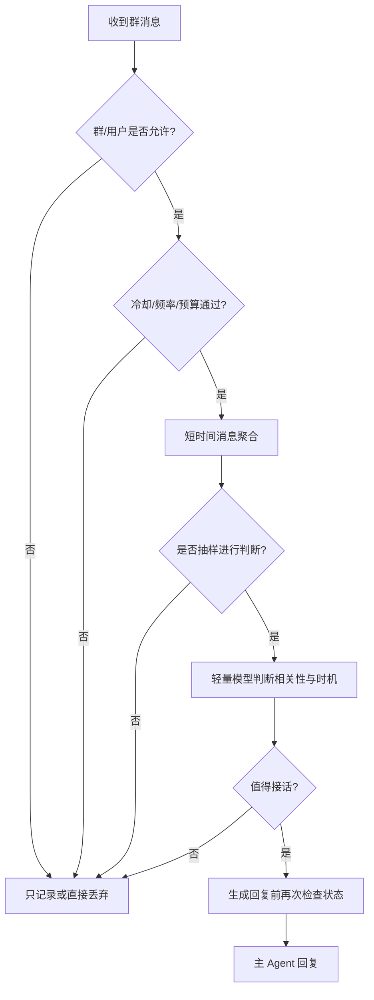

# 主动行为 · 智能插话与主动发起

## 问题定义

一个群聊中的 Bot 不应只依赖 @，但也不应该随机打断正常交流。Miubot 将主动行为分成两种机制：**智能插话**（在已有对话中择机参与）和 **主动发起**（无明确触发时启动新话题）。二者需要不同触发器、权限和频率限制。

## 页面结构

```text
主动行为
[智能插话] [主动发起] [全局限制] [决策记录]
模式：关闭 / 纯概率 / 智能判断 / 混合
规则：会话范围、静默时段、冷却、预算、消息窗口
判断：轻量模型、判断提示词（高级项）、阈值
效果：命中次数、实际发送次数、被拦截原因
```

## 智能插话推荐流程



### 模式定义

- **关闭**：不主动插话，仅显式触发照常回复。
- **纯概率**：消息窗口触发概率抽样后直接进入回复（仍需冷却、权限、限频）；简单但自然度较差。
- **智能判断**：规则筛选后，每个有效聚合窗口交给轻量模型判断。
- **混合**：规则/概率用于节省判断成本，再由模型决定是否接话；**推荐默认策略**，但新群默认建议关闭并由用户开启。

### 判断模型输出（结构化示例）

```json
{"shouldReply": true, "topic": "群友在讨论脚本报错", "reasonCode": "useful_answer", "confidence": 0.82}
```

这只是供程序消费的外显决策字段，不是要求模型暴露内部推理链。可列举的原因码包括：`directly_relevant, helpful_answer, conversation_closed, interruption_risk, cooldown, budget, no_context`。

## 注意力与消息窗口

- 收集最近 N 秒或 N 条相关消息形成一个“话题窗口”，而不是每条消息独立请求 LLM。
- Bot 刚回应某人、对方继续引用 Bot 时，可短期提高该线程关注度；关注度随时间衰减。
- 同时有多个话题时利用 @/引用关系优先组织话题；无法确定时宁可不插话。
- 实际发送之前再次确认会话未停用、未超出冷却和预算、当前话题未明显过期。

## 主动发起

候选触发器：定时、群长时间安静、用户允许的周期问候、特定事件达成。执行前检查平台是否支持主动消息、会话是否 opt-in、静默时段与每日上限，并为每次发送产生审计记录。**首次启用需要明确选择目标群/用户，不给所有已接入群默认群发。**

## 风控与开关

- 全局：默认关闭、每日预算与发送总上限、系统紧急暂停。
- Bot：默认策略、单实例限频。
- 会话：是否启用、冷却、触发时段、覆盖模型和发言风格。
- 群成员：屏蔽用户、禁止针对特定人主动互动；权限最低限值不可被下层覆盖提高。

## UI 可观察性

展示最近判断：输入窗口摘要、命中筛选、模型决定、规则原因码、最终是否发出；从每条决策跳转调试 Trace。统计 `候选窗口 / 判断调用 / 计划回复 / 实际发送 / 被限频拦截`，用于调节自然度和成本。

## 验收

1. 全局与群配置关闭时不得主动发言。
2. 高频刷屏时不会对每条消息分别调用判断模型；聚合与频率限制生效。
3. 决策通过后若会话被禁用，发送前复查阻止发言。
4. 智能插话模型故障可降级为静默，不无限随机发言。
5. 每次主动发言可追溯触发器、决策、模型、发送回执。
